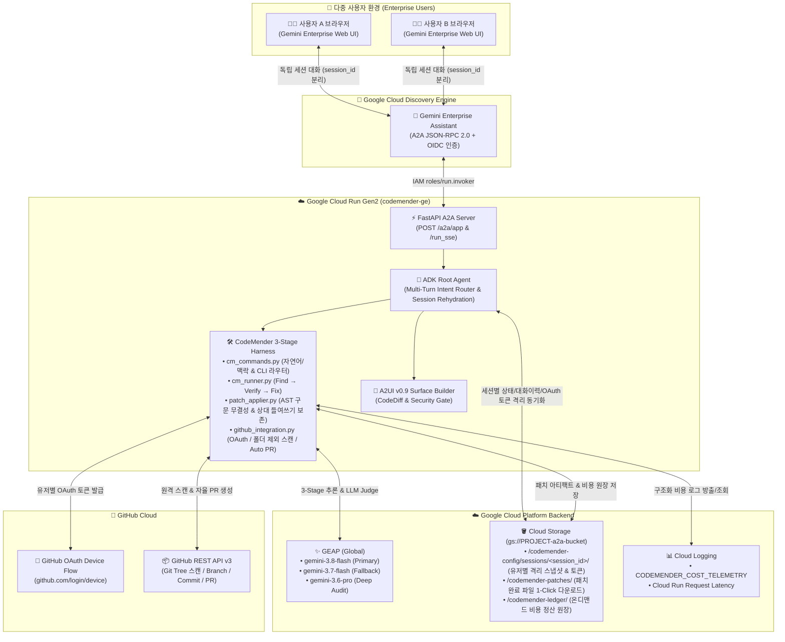
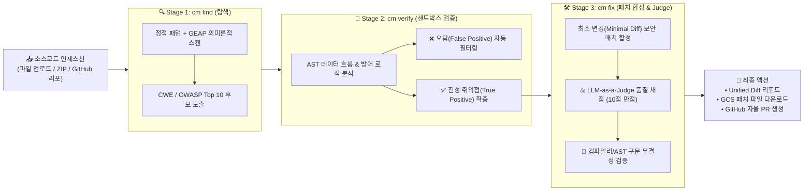
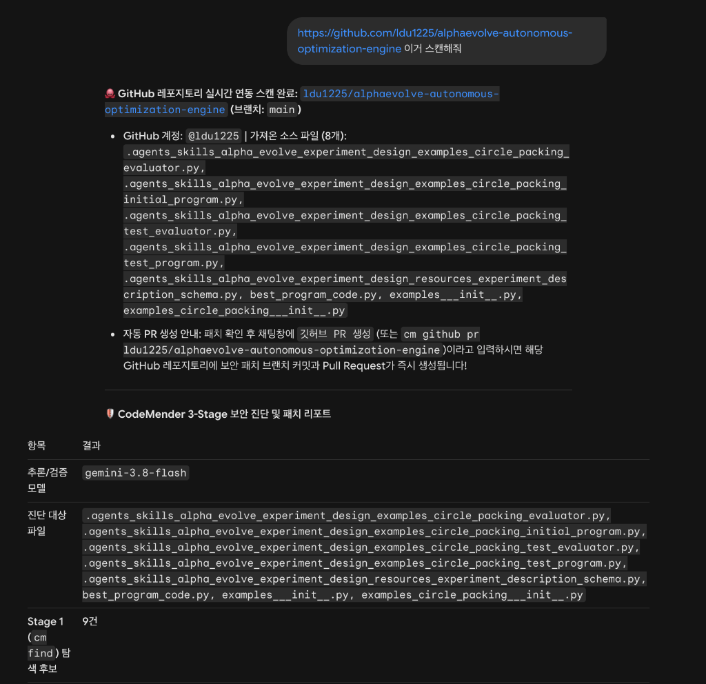
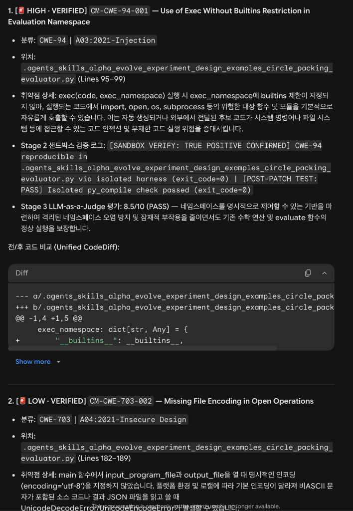
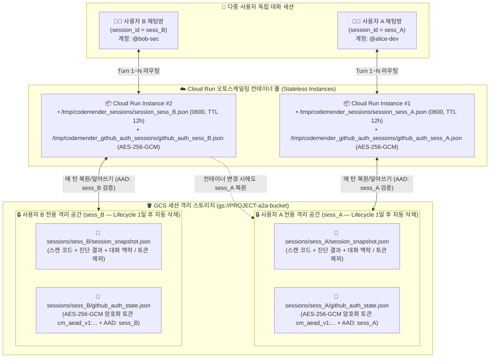
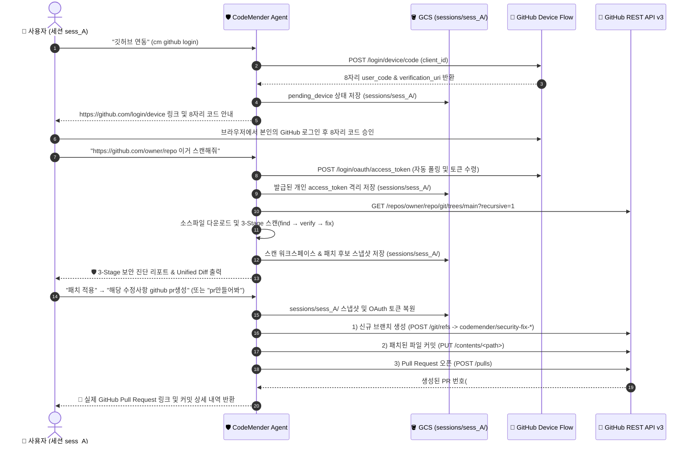
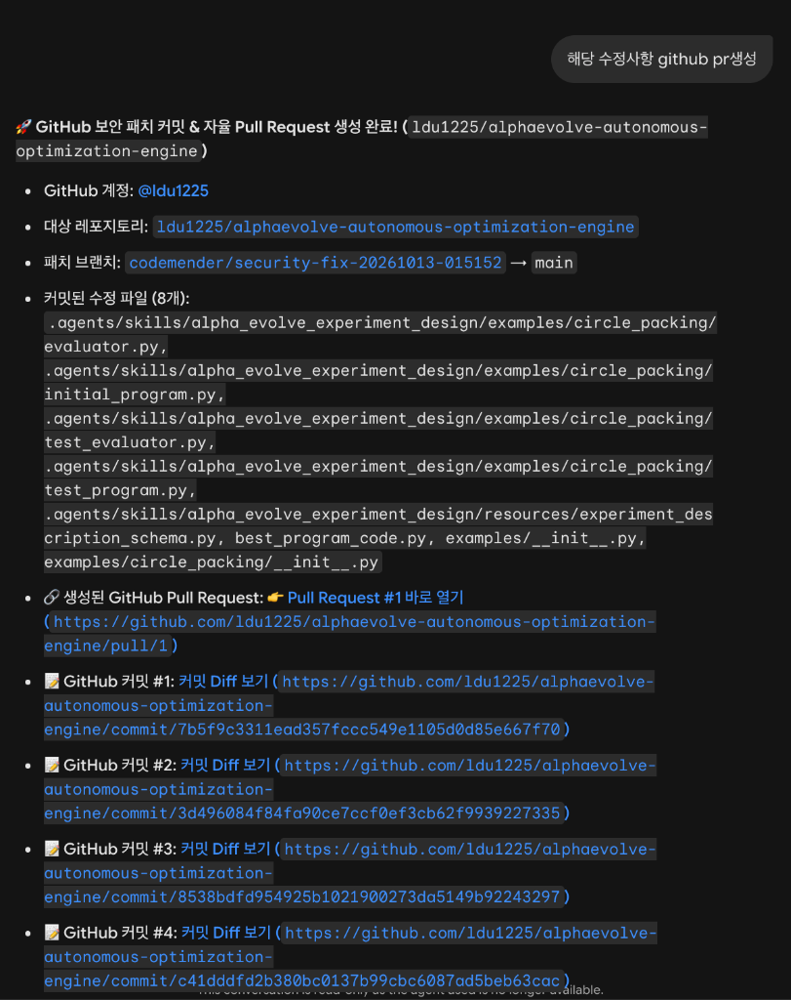
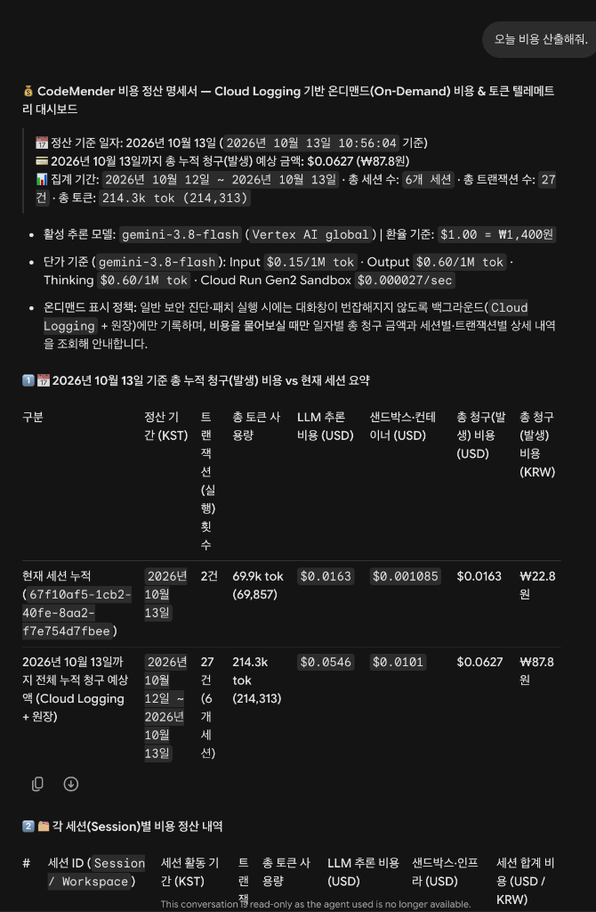

# 🛡️ CodeMender Security Agent for Gemini Enterprise (`codemender-ge`)

[](https://a2a-protocol.org/)
[](https://a2ui.org/)
[](https://adk.dev/)
[](#)
[](#23-멀티유저-세션-격리per-session-isolation-및-cloud-run-무상태-복원-아키텍처)
[](#)

**CodeMender Security Agent**(`codemender-ge`)는 Google DeepMind의 **CodeMender**(`cm` v0.12.0) 자율 보안 에이전트 아키텍처를 **Google Cloud Gemini Enterprise**(Discovery Engine) 환경에 완벽하게 통합한 엔터프라이즈 보안 진단 · 샌드박스 취약점 검증 · 자동 패치 · GitHub 자율 PR 생성 에이전트입니다.

누구나 이 저장소를 클론한 뒤 `.env` 파일에 **본인의 GCP 프로젝트 ID**(`GOOGLE_CLOUD_PROJECT`) **단 하나만 입력**하고 `./scripts/deploy_and_register_ge.sh`를 실행하면, **인프라 프로비저닝 → Cloud Run 배포 → IAM 권한 부여 → Gemini Enterprise 에이전트 자동 등록**까지 전 과정이 원클릭으로 완료됩니다.

---

## 📑 목차 (Table of Contents)

1. [✨ 핵심 기능 요약 (Key Capabilities)](#-1-핵심-기능-요약-key-capabilities)
2. [🏗️ 시스템 아키텍처 상세 (System Architecture)](#-2-시스템-아키텍처-상세-system-architecture)
   - [2.1 전체 엔드투엔드 인프라 및 A2A/A2UI 아키텍처](#21-전체-엔드투엔드-인프라-및-a2aa2ui-아키텍처)
   - [2.2 3-Stage 자율 보안 파이프라인 (`cm find` → `cm verify` → `cm fix`)](#22-3-stage-자율-보안-파이프라인-cm-find--cm-verify--cm-fix)
   - [2.3 멀티유저 세션 격리(Per-Session Isolation) 및 Cloud Run 무상태 복원 아키텍처](#23-멀티유저-세션-격리per-session-isolation-및-cloud-run-무상태-복원-아키텍처)
   - [2.4 GitHub OAuth Device Flow 연동 및 자율 보안 PR(Pull Request) 아키텍처](#24-github-oauth-device-flow-연동-및-자율-보안-prpull-request-아키텍처)
   - [2.5 Billing 권한 불필요(Billing-Free) Cloud Logging 기반 온디맨드 비용 정산](#25-billing-권한-불필요billing-free-cloud-logging-기반-온디맨드-비용-정산)
3. [📋 사전 준비 사항 (Prerequisites)](#-3-사전-준비-사항-prerequisites)
4. [🚀 고객용 단계별 완벽 설치 가이드 (Step-by-Step Onboarding)](#-4-고객용-단계별-완벽-설치-가이드-step-by-step-onboarding)
   - [Step 1: 저장소 클론 및 패키지 설치](#step-1-저장소-클론-및-패키지-설치)
   - [Step 2: `.env` 환경 변수 설정 (상세 가이드)](#step-2-env-환경-변수-설정-상세-가이드)
   - [Step 3: 원클릭 배포 및 Gemini Enterprise 자동 등록](#step-3-원클릭-배포-및-gemini-enterprise-자동-등록)
   - [Step 4: 3단계 E2E 설치 검증 실행](#step-4-3단계-e2e-설치-검증-실행)
5. [💻 Gemini Enterprise 실전 사용 가이드 (실제 화면 & 5대 시나리오)](#-5-gemini-enterprise-실전-사용-가이드-실제-화면--5대-시나리오)
6. [⌨️ 전체 명령어 레퍼런스 (`cm` v0.12.0 13개 카테고리)](#-6-전체-명령어-레퍼런스-cm-v0120-13개-카테고리)
7. [📂 디렉터리 및 모듈 아키텍처 상세](#-7-디렉터리-및-모듈-아키텍처-상세)
8. [🔧 운영 · 클린 재설치 · 삭제 · 트러블슈팅 가이드](#-8-운영--클린-재설치--삭제--트러블슈팅-가이드)

---

## ✨ 1. 핵심 기능 요약 (Key Capabilities)

| 영역 | 핵심 기능 | 기술적 특징 |
| :--- | :--- | :--- |
| **🧠 멀티턴 맥락 & 의도 라우터** | `cm_chat_history` + LLM Intent Router | 하드코딩 키워드 매칭의 한계를 넘어 직전 대화 맥락(`"codemender-ge레포"` → `"sample폴더외에 다 스캔해"` → `"뭔데 이게"`)을 기억하고, 일반 질문·파일 출처 질문·보안 명령을 정확히 분기 |
| **🔍 3-Stage 자율 보안 엔진** | `cm find` → `cm verify` → `cm fix` | 정적/의미론적 스캔(Stage 1) → 샌드박스 AST/데이터흐름 검증으로 오탐(False Positive) 제거(Stage 2) → 상대 들여쓰기 보존 및 `ast.parse` 구문 무결성 검증 패치 합성(Stage 3) |
| **🔒 멀티유저 세션 완벽 격리** | `session_id` 기반 GitHub 토큰 & 워크스페이스 분리 | 다수의 임직원이 동시에 사용해도 사용자 A의 개인 GitHub OAuth 토큰과 스캔 코드가 사용자 B에게 절대 노출되지 않으며, Cloud Run 오토스케일링 시에도 세션별 GCS 스냅샷으로 무중단 복원 |
| **🐙 GitHub OAuth · 경로 제외 스캔 · 자율 PR** | 원격 리포지토리 필터 스캔 & Pull Request 자동 오픈 | 비공개/공개 레포 필터 조회(`내 레포 목록 프라이빗만`), 특정 폴더 제외 스캔(`sample폴더외에 다 스캔해`), 외부 타인 레포 권한(`can_push`) 자동 판별 및 보안 PR 자동 생성 |
| **🖥️ A2A v0.3.0 & A2UI v0.9** | 양방향 인터랙티브 보안 대시보드 | Gemini Enterprise 채팅창 호환 고가독성 Markdown 리포트 + A2UI v0.9 카탈로그(`SeverityBadge`, `CodeDiff`, `PatchApprovalGate`) 동시 방출 |
| **📥 GCS 원클릭 다운로드** | 패치 완료 파일 & ZIP 패키지 영구 보관 | 컨테이너 임시 디스크(`/tmp`)의 한계를 극복하여 고객의 GCS 버킷(`gs://<PROJECT>-a2a-bucket`)에 자동 동기화 및 브라우저 즉시 다운로드 링크 제공 |
| **💰 온디맨드 비용 텔레메트리** | Billing API 권한 없이 실시간 비용 정산 | 평소 작업 시에는 화면 노이즈를 만들지 않으며, 사용자가 `오늘 비용 산출해줘` 또는 `cm cost`를 호출할 때만 Cloud Logging과 영구 원장을 대조해 KST 기준 USD·KRW 정산 명세서 출력 |

---

## 🏗️ 2. 시스템 아키텍처 상세 (System Architecture)

### 2.1 전체 엔드투엔드 인프라 및 A2A/A2UI 아키텍처

Gemini Enterprise 웹 UI부터 Cloud Run 에이전트 컨테이너, GEAP 추론 엔진, GCS 세션 격리 스토리지, 그리고 GitHub REST API v3까지의 전체 데이터 흐름입니다.



---

### 2.2 3-Stage 자율 보안 파이프라인 (`cm find` → `cm verify` → `cm fix`)

단순 정적 분석기(SAST)는 안전한 코드까지 취약점으로 잘못 보고하는 **오탐**(False Positive) 비율이 높고, 일반 LLM 코드 수정은 원본 구문을 망가뜨리는 문제가 있습니다.  
CodeMender는 이를 해결하기 위해 **3단계 검증 파이프라인**을 수행합니다.



#### 📸 실제 구동 화면 1 — GitHub 저장소 스캔 및 Stage 2 샌드박스 오탐(False Positive) 자동 제거
사용자가 Gemini Enterprise 채팅창에 `https://github.com/ldu1225/alphaevolve-autonomous-optimization-engine 이거 스캔해줘`라고 입력하면, 원격 리포지토리의 소스 파일들을 가져와 Stage 1 후보 중 이미 방어 로직이 적용된 오탐(False Positive)을 Stage 2 샌드박스에서 자동으로 걸러내고 확증된 진성 취약점(True Positive)만 리포트합니다.



#### 📸 실제 구동 화면 2 — 확증 취약점 상세 분석, LLM Judge 점수 및 Unified CodeDiff
각 확증 취약점(`VERIFIED`)에 대해 **Stage 2 샌드박스 검증 로그**(`TRUE POSITIVE CONFIRMED`), **Stage 3 LLM-as-a-Judge 패치 품질 점수**(`8.5/10 PASS`), 그리고 수정 전후를 한눈에 비교하는 **Unified CodeDiff**를 출력합니다.



---

### 2.3 멀티유저 세션 격리(Per-Session Isolation) 및 Cloud Run 무상태 복원 아키텍처

엔터프라이즈 환경에서는 여러 임직원이 동시에 하나의 Gemini Enterprise 에이전트를 사용하며, 각자 본인의 개인 GitHub 계정이나 프라이빗 리포지토리를 연동합니다.  
이때 **사용자 A가 연동한 개인 GitHub 토큰이나 스캔 중인 소스코드를 다른 채팅방의 사용자 B가 볼 수 있으면 안 된다**는 보안 요구사항과, **Cloud Run이 여러 컨테이너로 오토스케일링되더라도 내 멀티턴 작업(`스캔` → `패치` → `PR 생성`)은 끊기면 안 된다**는 가용성 요구사항을 동시에 해결해야 합니다.

#### 🔐 핵심 보안 및 수명 주기(Lifecycle) 설계 원칙 4가지

1. **OAuth App `client_id` (공용 식별자) vs 사용자별 `access_token` (완벽 분리)**
   - GitHub OAuth Device Flow에서 `client_id`는 "이 로그인 요청을 보내는 애플리케이션이 CodeMender이다"라고 알려주는 **앱 식별자**(Public Identifier)이므로 모든 사용자가 동일한 값을 사용합니다.
   - 반면 각 사용자가 브라우저(`https://github.com/login/device`)에서 본인의 GitHub 계정으로 로그인해 8자리 코드를 승인하면, GitHub은 **해당 사용자 전용 토큰**(`access_token`: `gho_...`)을 발급합니다.
2. **`session_id` 바인딩 AES-256-GCM 암호화 저장 (`Zero Plaintext Token at Rest`)**
   - 발급된 GitHub `access_token`과 `device_code`는 로컬 디스크(`/tmp`)나 GCS 버킷에 **절대 평문(Plaintext)으로 저장되지 않습니다.**
   - PBKDF2-HMAC-SHA256(100,000회 반복)으로 유도된 세션별 전용 키와 `codemender-session:<session_id>` 연관 인증 데이터(AAD)를 사용한 **AES-256-GCM(`cm_aead_v1:...`) 암호문**으로만 저장되며, `session_snapshot.json`에서도 토큰 필드는 완전히 제거(Strip)됩니다.
   - 따라서 GCP 프로젝트 관리자나 개발자가 GCS 콘솔에서 `github_auth_state.json` 파일을 직접 다운로드해 열어봐도 평문 토큰을 볼 수 없으며, 설령 사용자 A의 암호화 파일을 사용자 B의 세션 경로로 복사하더라도 AAD 불일치로 복호화가 즉시 거부되고 파일이 자동 파기됩니다.
3. **Cloud Run 오토스케일링 무중단 스냅샷 복원 (`Rehydration`)**
   - Cloud Run은 무상태(Stateless) 환경이므로 1턴(`스캔해줘`)을 처리한 컨테이너 #1과 2턴(`패치 적용` / `PR 만들어봐`)을 처리하는 컨테이너 #2가 서로 다를 수 있습니다.
   - CodeMender는 매 턴이 시작될 때 현재 `session_id`의 스냅샷을 GCS에서 즉시 복원(Rehydrate)하고, 턴이 끝날 때 변경된 상태를 같은 `session_id` 경로에 덮어쓰기(Overwrite)합니다.
4. **무한 증식 원천 차단 — 애플리케이션 TTL(12시간) + GCS 버킷 Lifecycle 자동 삭제**
   - **애플리케이션 레벨 TTL & 즉시 물리 삭제**: 모든 세션 스냅샷과 암호화 토큰에는 만료 시각(`expires_at_epoch`, 기본 12시간)이 부여됩니다. 만료된 파일이나 `깃허브 연동 해제` 요청 시 빈 값을 덮어쓰는 것이 아니라 로컬 파일(`unlink`)과 GCS 객체(`HTTP DELETE`)를 **물리적으로 즉시 삭제**합니다. 또한 컨테이너 `/tmp` 내 만료된 세션/워크스페이스 디렉터리도 자동 청소됩니다.
   - **GCS Bucket Lifecycle 자동 청소**: 배포 스크립트([`scripts/deploy_and_register_ge.sh`](scripts/deploy_and_register_ge.sh))가 버킷에 수명 주기 규칙을 자동 설정하여, `codemender-config/sessions/` 하위 객체는 **생성 1일 후**, `codemender-patches/` 하위 패치 아티팩트는 **생성 7일 후 GCP가 자동으로 영구 삭제**합니다. (단, 비용 정산 원장인 `codemender-ledger/`는 영구 보존됩니다.)



#### 📊 멀티유저 세션 격리 · 암호화 · 자동 삭제 매핑표

| 데이터 항목 | 컨테이너 로컬 캐시 경로 (`0o600` 권한) | GCS 격리 경로 (`gs://<BUCKET>/...`) | 저장 형태 (암호화 여부) | 자동 삭제 주기 (TTL / Lifecycle) |
| :--- | :--- | :--- | :---: | :---: |
| **GitHub OAuth 토큰** (`encrypted_access_token`) | `/tmp/codemender_github_auth_sessions/github_auth_<session_id>.json` | `codemender-config/sessions/<session_id>/github_auth_state.json` | **🔐 AES-256-GCM 암호화 (`cm_aead_v1:`)** | **12시간 TTL (GCS Lifecycle 1일)** |
| **스캔된 소스코드 & 맥락** (`cm_workspace`) | `/tmp/codemender_sessions/session_<session_id>.json` | `codemender-config/sessions/<session_id>/session_snapshot.json` | 토큰 제거된 세션 JSON | **12시간 TTL (GCS Lifecycle 1일)** |
| **패치 완료 다운로드 파일** (`patched_*`) | `/tmp/codemender_workspaces/<session_id>/` | `codemender-patches/<session_id>/` | 패치 아티팩트 | **GCS Lifecycle 7일 후 자동 삭제** |
| **온디맨드 비용 정산 원장** (`ledger`) | `/tmp/codemender_cost_ledger.json` | `codemender-ledger/cost_ledger.json` | 비용/토큰 집계 메타데이터 | **♾️ 영구 보존 (비용 감사 추적용)** |


---

### 2.4 GitHub OAuth Device Flow 연동 및 자율 보안 PR(Pull Request) 아키텍처

CodeMender는 별도의 외부 MCP 서버나 복잡한 Webhook 설정 없이, **순수 Python GitHub REST API v3 클라이언트**([`app/harness/github_integration.py`](app/harness/github_integration.py))와 **OAuth 2.0 Device Flow**를 내장하고 있습니다.



#### 📸 실제 구동 화면 3 — 채팅 한 줄(`"해당 수정사항 github pr생성"`)로 자율 생성된 GitHub Pull Request
사용자가 스캔 및 패치 후 `해당 수정사항 github pr생성`(또는 `pr만들어봐`)이라고 입력하면, 에이전트가 자동으로 보안 패치 전용 브랜치(`codemender/security-fix-*`)를 만들고 수정된 파일들을 커밋한 뒤 **실제 GitHub Pull Request**를 오픈하여 클릭 가능한 링크를 반환합니다.



---

### 2.5 Billing 권한 불필요(Billing-Free) Cloud Logging 기반 온디맨드 비용 정산

기업 환경에서 일반 개발자나 보안 담당자는 GCP Billing Account 조회 권한(`roles/billing.viewer`)이 없는 경우가 대부분입니다.  
본 에이전트는 **Cloud Billing API 권한 없이도 100% 정확한 비용 추적이 가능하도록 Cloud Logging 이중 파이프라인과 GCS 영구 원장**([`app/harness/cost_tracker.py`](app/harness/cost_tracker.py))을 결합했습니다.

- **평소 작업 시 노이즈 제로(Zero-Noise)**: 진단, 패치, GitHub PR 생성 등 일반 업무 대화에서는 비용 표를 출력하지 않고 백그라운드에서 구조화 로그(`CODEMENDER_COST_TELEMETRY`)와 원장에만 조용히 기록합니다.
- **온디맨드(On-Demand) 정산 명세서**: 사용자가 `오늘 비용 산출해줘`, `비용 조회`, `얼마 나왔어?`, `cm cost`라고 요청할 때만 즉시 호출되어 KST(한국 표준시) 기준 일자별·세션별·트랜잭션별 USD 및 KRW 비용을 정산합니다.

#### 📸 실제 구동 화면 4 — `"오늘 비용 산출해줘."` 입력 시 출력되는 온디맨드 비용 & 토큰 정산 명세서



---

## 📋 3. 사전 준비 사항 (Prerequisites)

설치를 진행할 로컬 PC(Mac / Linux / Cloud Shell)에 아래 도구가 준비되어 있어야 합니다.

1. **Google Cloud SDK (`gcloud`) 설치 및 로그인**
   ```bash
   gcloud auth login
   gcloud auth application-default login
   ```
2. **Python 패키지 매니저 (`uv`) 설치**
   ```bash
   curl -LsSf https://astral.sh/uv/install.sh | sh
   ```
3. **Google Agents CLI (`google-agents-cli`) 설치 (선택 사항 — 미설치 시에도 `gcloud run deploy`로 자동 폴백)**
   ```bash
   uv tool install google-agents-cli
   ```
4. **GCP 프로젝트 권한 확인**
   - 배포를 실행하는 계정에 대상 GCP 프로젝트의 `Owner` 또는 `Editor` 권한(세부 권한: `Cloud Run Admin`, `Storage Admin`, `Discovery Engine Admin`, `Service Usage Admin`, `Logging Admin`)이 있어야 합니다.
   - 대상 GCP 프로젝트에 **Gemini Enterprise**(Discovery Engine App)가 생성되어 있어야 합니다.

---

## 🚀 4. 고객용 단계별 완벽 설치 가이드 (Step-by-Step Onboarding)

### Step 1: 저장소 클론 및 패키지 설치

```bash
git clone https://github.com/ldu1225/codemender-ge.git
cd codemender-ge

# 가상환경 생성 및 의존성 패키지 설치
uv sync
```

### Step 2: `.env` 환경 변수 설정 (상세 가이드)

저장소 루트에 있는 템플릿 파일([`.env.example`](.env.example))을 복사하여 `.env` 파일을 생성합니다. (`.env` 파일은 `.gitignore`에 등록되어 있어 Git에 커밋되지 않습니다.)

```bash
cp .env.example .env
```

텍스트 에디터로 `.env` 파일을 열고 `GOOGLE_CLOUD_PROJECT`에 본인의 GCP 프로젝트 ID를 입력합니다:

```ini
# [필수] 1. 고객의 Google Cloud 프로젝트 ID (이 값 하나만 입력해도 바로 작동합니다!)
GOOGLE_CLOUD_PROJECT="my-company-gcp-project"

# [선택] 2. Gemini Enterprise 설정
# - GE_LOCATION: Gemini Enterprise 앱 리전 ("us", "eu", "global" 중 선택, 기본값 "us")
# - GE_ENGINE_ID: 비워두면("") 배포 스크립트가 프로젝트 내 Gemini Enterprise 엔진을 자동으로 찾아 연결합니다!
GE_LOCATION="us"
GE_ENGINE_ID=""

# [선택] 3. Cloud Run 및 GEAP 리전 설정
CLOUD_RUN_REGION="us-central1"
GOOGLE_CLOUD_LOCATION="global"
SERVICE_NAME="codemender-ge"
AGENT_DISPLAY_NAME="CodeMender Security Agent (Gemini 3.8 Flash)"

# [선택] 4. CodeMender 추론 모델 및 환율 설정
CODEMENDER_MODEL="gemini-3.8-flash"
CODEMENDER_FALLBACK_MODEL="gemini-3.7-flash"
CM_USD_TO_KRW_RATE="1380.0"

# [선택] 5. 패치 파일 다운로드, 세션 격리 스냅샷 및 비용 원장용 GCS 버킷
# - 비워두면("") 자동으로 "${GOOGLE_CLOUD_PROJECT}-a2a-bucket" 이름으로 버킷을 생성합니다.
CM_GCS_ARTIFACT_BUCKET=""

# [선택] 6. GitHub 연동 및 세션 보안 (AES-256-GCM 암호화 & TTL 만료) 설정
# - 비워두면("") 채팅창에서 `깃허브 연동` 입력 시 표준 GitHub Device Flow(8자리 코드 인증)가 작동하며,
#   발급된 토큰은 각 사용자의 대화 세션(session_id)별로 AES-256-GCM 암호화(`cm_aead_v1:`)되어 격리 저장됩니다.
GITHUB_OAUTH_CLIENT_ID=""
GITHUB_TOKEN=""
CM_TOKEN_ENCRYPTION_KEY=""
CM_GITHUB_TOKEN_TTL_SECONDS="43200"
CM_SESSION_TTL_SECONDS="43200"
```

#### 📊 환경 변수 상세 요약표

| 변수명 | 필수 여부 | 기본값 (비워둘 경우) | 설명 |
| :--- | :---: | :--- | :--- |
| `GOOGLE_CLOUD_PROJECT` | **✅ 필수** | 없음 | 배포할 대상 Google Cloud 프로젝트 ID |
| `GE_LOCATION` | 선택 | `us` | Gemini Enterprise(Discovery Engine) 멀티 리전 (`us`, `eu`, `global`) |
| `GE_ENGINE_ID` | 선택 | **자동 탐색** | 비워두면 프로젝트 내 최신 Gemini Enterprise Engine ID를 API로 자동 조회 |
| `CLOUD_RUN_REGION` | 선택 | `us-central1` | Cloud Run 서비스가 배포될 리전 |
| `GOOGLE_CLOUD_LOCATION` | 선택 | `global` | GEAP Gemini 모델 엔드포인트 리전 (`global` 권장) |
| `SERVICE_NAME` | 선택 | `codemender-ge` | Cloud Run 서비스 이름 |
| `AGENT_DISPLAY_NAME` | 선택 | `CodeMender Security Agent (Gemini 3.8 Flash)` | Gemini Enterprise 에이전트 목록에 표시될 이름 |
| `CODEMENDER_MODEL` | 선택 | `gemini-3.8-flash` | 기본 보안 추론 및 검증 모델 |
| `CODEMENDER_FALLBACK_MODEL` | 선택 | `gemini-3.7-flash` | 기본 모델 호출 실패 시 자동 전환될 폴백 모델 |
| `CM_GCS_ARTIFACT_BUCKET` | 선택 | `<PROJECT_ID>-a2a-bucket` | 세션별 격리 스냅샷, 수정 파일 원클릭 다운로드, 비용 원장 저장용 GCS 버킷 |
| `GITHUB_OAUTH_CLIENT_ID` | 선택 | 표준 GitHub Device Flow | 커스텀 GitHub OAuth App Client ID (선택) |
| `GITHUB_TOKEN` | 선택 | 없음 | 단일 고정 GitHub PAT을 사용할 경우에만 입력 (비워두면 유저별 OAuth Device Flow 작동) |
| `CM_TOKEN_ENCRYPTION_KEY` | 선택 | 프로젝트+세션 고유 유도키 | GitHub OAuth 토큰 AES-256-GCM 암호화용 마스터 시드 키 |
| `CM_GITHUB_TOKEN_TTL_SECONDS` | 선택 | `43200` (12시간) | 세션별 GitHub OAuth 토큰 자동 만료 및 물리 삭제 주기(초) |
| `CM_SESSION_TTL_SECONDS` | 선택 | `43200` (12시간) | 세션 워크스페이스 스냅샷 자동 만료 및 물리 삭제 주기(초) |

---

### Step 3: 원클릭 배포 및 Gemini Enterprise 자동 등록

이제 아래 스크립트 한 줄만 실행하면 모든 설치가 자동으로 진행됩니다:

```bash
./scripts/deploy_and_register_ge.sh
```

#### 🔍 스크립트가 자동으로 수행하는 5단계 프로비저닝 과정:
1. **`[1/5]` Preparing GCP Project & Provisioning Resources**
   - 프로젝트 번호(`PROJECT_NUMBER`) 조회 및 `GE_ENGINE_ID` 자동 탐색
   - 필수 API 8종(`run`, `cloudbuild`, `artifactregistry`, `aiplatform`, `discoveryengine`, `logging`, `monitoring`, `storage`) 자동 활성화
   - GCS 버킷(`gs://<PROJECT_ID>-a2a-bucket`) 존재 여부 확인 및 미존재 시 자동 생성
   - **GCS 버킷 수명 주기(Lifecycle) 자동 청소 정책 설정** (`codemender-config/sessions/` 1일 후 자동 삭제, `codemender-patches/` 7일 후 자동 삭제, `codemender-ledger/` 영구 보존)
   - Cloud Logging 비용 메트릭(`codemender_cost_events`) 존재 여부 확인 및 자동 생성
2. **`[2/5]` Deploying CodeMender Agent to Cloud Run**
   - 소스코드 컨테이너 빌드 및 Cloud Run Gen2 배포 (`.env` 환경 변수 자동 주입)
3. **`[3/5]` Configuring IAM Permissions**
   - Discovery Engine 서비스 계정(`service-<PROJECT_NUMBER>@gcp-sa-discoveryengine.iam.gserviceaccount.com`)에 Cloud Run 호출 권한(`roles/run.invoker`) 자동 부여
4. **`[4/5]` Registering CodeMender A2A + A2UI v0.9 Agent in Gemini Enterprise**
   - 배포된 Cloud Run의 `/.well-known/agent-card.json`을 읽어 Discovery Engine REST API(`v1alpha`)를 통해 Gemini Enterprise의 에이전트로 자동 등록(또는 기존 에이전트 업데이트)
5. **`[5/5]` Deployment & Registration Complete**
   - 배포된 Cloud Run 엔드포인트 및 등록된 Gemini Enterprise 에이전트 리소스 ID 출력

---

### Step 4: 3단계 E2E 설치 검증 실행

배포가 정상적으로 완료되었는지 로컬/클라우드/Gemini Enterprise 3단계를 한 번에 테스트하려면 아래 명령어를 실행합니다:

```bash
./scripts/deploy_and_register_ge.sh --test
```

- **`[Test 1/3]`** — 로컬 ADK `/run_sse` 엔드포인트 멀티턴 테스트 (`안녕` → `샘플 진단 실행` → `패치 적용` → `비용 조회`)
- **`[Test 2/3]`** — 라이브 Cloud Run `/a2a/app` JSON-RPC 멀티턴 테스트 (`안녕` → `샘플 진단 실행` → `cm triage` → `cm fix` → `cm artifacts` → `cm stats`)
- **`[Test 3/3]`** — Gemini Enterprise Discovery Engine 에이전트 등록 상태(`ENABLED`) 검증

---

## 💻 5. Gemini Enterprise 실전 사용 가이드 (실제 화면 & 5대 시나리오)

Gemini Enterprise 웹 콘솔 좌측 메뉴의 **Agents** 탭에서 `CodeMender Security Agent (Gemini 3.8 Flash)`를 선택하고 아래 시나리오대로 대화해 보세요. 띄어쓰기 없는 자연어(예: `내래포목록 프라이빗만`, `codemender-ge레포`, `sample폴더외에 다 스캔해`, `패치적용`, `pr만들어봐`, `모델 관리`)와 일상 질문/후속 질문도 **멀티턴 대화 맥락(`cm_chat_history`)과 의도 라우터**가 자연스럽게 인식합니다.

### 시나리오 1: GitHub 저장소 멀티턴 맥락 스캔 · 폴더 제외 스캔 · 자율 보안 PR 생성 (`cm github`)
1. `깃허브 연동` (`cm github login`) 입력 → 화면에 안내된 [https://github.com/login/device](https://github.com/login/device) 링크를 클릭하고 **8자리 인증 코드** 입력 (내 현재 대화 세션에만 안전하게 격리 연동됨)
2. `내 레포 목록` 또는 `내 래포목록 프라이빗만` (`cm repo list --visibility private`) 입력 → 내 GitHub 계정의 전체 또는 비공개(Private)/공개(Public) 리포지토리 필터 조회
3. **방법 A (직접 URL/이름 스캔)**: `https://github.com/<소유자>/<저장소명> 이거 스캔해줘` 입력  
   **방법 B (멀티턴 맥락 & 폴더 제외 스캔)**:
   - 1턴: `codemender-ge레포` 입력 → 에이전트가 해당 저장소를 현재 세션의 타겟 레포지토리(`cm_target_repo`)로 설정하고 원하는 작업을 안내
   - 2턴: `sample폴더외에 다 스캔해` 입력 → 직전 턴에 지정한 `codemender-ge` 저장소에서 `sample`, `samples` 디렉터리를 자동으로 제외(`exclude_paths`)하고 나머지 소스 파일만 가져와 3-Stage 보안 스캔 수행
   - 3턴: `뭔데 이게` 또는 `이 파일이 지금 어디에 있는건데?` 입력 → 불필요한 재스캔 없이 방금 실행된 진단 리포트 내용과 파일 출처(GitHub 원격 저장소 vs 컨테이너 내장 데모 파일)를 맥락에 맞게 설명
4. `패치 적용` (또는 `cm fix ALL`) 입력 → 검출된 취약점 일괄 보안 패치 적용 (`ast.parse` 구문 무결성 및 상대 들여쓰기 자동 보존)
5. `해당 수정사항 github pr생성` (또는 `pr만들어봐`) 입력 →
   - 스캔했던 리포지토리를 자동으로 기억하여 원격 GitHub 저장소에 `codemender/security-fix-YYYYMMDD-*` 브랜치 자동 생성
   - 패치된 모든 파일 자동 커밋 및 **실제 GitHub Pull Request 자동 오픈** (타인의 공개 저장소처럼 Push 권한이 없는 레포지토리인 경우 스캔 시점부터 `Read-Only` 권한을 감지하여 Fork 가이드를 친절히 안내)

### 시나리오 2: 원클릭 샘플 보안 진단 및 자동 패치
1. `안녕` 입력 → 에이전트가 지원하는 전체 `cm` 명령어 가이드 및 상태 대시보드 확인
2. `샘플 진단 실행` 입력 → 내장된 결제 서비스(`vulnerable_payment_service.py`)에 대해 3-Stage 스캔(`cm find` → `cm verify` → `cm fix`) 실행, CWE-89 SQL Injection 및 CWE-78 OS Command Injection 검출 및 Unified Diff 확인
3. `패치 적용` 입력 → 보안 패치가 실제 파일에 적용되고, AST 구문 무결성 검증 결과 및 **GCS 원클릭 다운로드 링크** 즉시 출력

### 시나리오 3: 파일/ZIP 업로드 스캔 및 수정본 원클릭 다운로드 (`cm artifacts`)
1. 채팅창의 `+` (파일 첨부) 버튼을 눌러 취약한 `.py`, `.c`, `.js`, `.go`, `.java` 파일 또는 프로젝트 `.zip` 아카이브를 첨부하고 `이 파일 보안 진단해줘` 입력
2. 진단 완료 후 `패치 적용` (`cm fix ALL`) 입력하여 전체 취약점 자동 패치
3. `수정한 파일 다운로드` 또는 `cm artifacts` 입력 →
   - **① 브라우저 원클릭 개별 파일 다운로드 링크**
   - **② 전체 패치 파일 `.zip` 패키지 원클릭 다운로드 링크**
   - **③ GCS 영구 경로**(`gs://...`) **및 수정된 전체 소스코드 전문** 확인

### 시나리오 4: 온디맨드(On-Demand) 실시간 비용 및 토큰 정산 조회 (`cm cost`)
- 채팅창에 `오늘 비용 산출해줘`, `비용 조회`, `얼마 나왔어?`, 또는 `cm cost` 입력
- 최초 사용일부터 오늘 날짜까지의 **총 청구 비용**(USD / KRW), **일자별 청구 집계표**(Daily), **현재 세션 및 전체 누적 트랜잭션 원장**, 그리고 **세션별 집계표**(Per-Session)를 한눈에 확인합니다.

### 시나리오 5: 멀티모델 관리 및 엔터프라이즈 감사 리포트 (`cm models` / `cm report`)
- `모델 관리` 또는 `cm models` 입력 → 현재 활성화된 모델 확인 및 `gemini-3.8-flash`, `gemini-3.8-flash-cyber`, `gemini-3.7-flash` 단가·특화 영역 비교
- `cm report -f json` 입력 → GitHub Advanced Security(CodeQL)에 바로 업로드할 수 있는 **SARIF v2.1.0 표준 JSON 리포트** 생성
- `cm report -f html` 입력 → 경영진/보안 감사 제출용 HTML 보안 감사 보고서 생성

---

## ⌨️ 6. 전체 명령어 레퍼런스 (`cm` v0.12.0 13개 카테고리)

자연어(한국어/영어) 또는 아래 `cm` CLI 명령어를 채팅창에 그대로 입력할 수 있습니다:

| # | 카테고리 | 명령어 (CLI / 자연어 예시) | 설명 |
| :-: | :--- | :--- | :--- |
| **1** | **초기화** | `cm init [--verify]` / `워크스페이스 초기화` | 격리 샌드박스 워크스페이스 초기화 및 GEAP/컴파일러 상태 점검 |
| **2** | **취약점 탐지 (Stage 1)** | `cm find [<path>]` / `샘플 진단 실행` | 정적/의미론적 취약점 스캔 및 CWE/OWASP 매핑 |
| **3** | **PoC 검증 (Stage 2)** | `cm verify [<id\|ALL>]` / `샌드박스 검증` | 샌드박스 AST/데이터흐름 검증 및 오탐(False Positive) 필터링 |
| **4** | **보안 패치 (Stage 3)** | `cm fix [<id\|ALL>] [-c "<지침>"]` / `패치 적용` | 보안 패치 생성·적용, 커스텀 지침(`-c`) 반영, 또는 원본 롤백(`--revert`) |
| **5** | **트리아지 & 게이트** | `cm triage` / `트리아지` / `보안 게이트` | CVSS v3.1 기반 P0~P3 우선순위 매트릭스 및 CI/CD Security Gate(`PASS`/`BLOCK`) 판정 |
| **6** | **감사 리포트** | `cm report [-f text\|json\|html]` / `리포트 내보내기` | 텍스트 요약, **SARIF v2.1.0 JSON**, 또는 엔터프라이즈 HTML 보고서 출력 |
| **7** | **형상 관리 (VCS)** | `cm vcs status \| diff \| stage \| reset` / `버전 관리` | 수정 파일 해시 확인, Git Unified Diff, 커밋 메시지 생성, 워크스페이스 초기화 |
| **8** | **빌드 & 회귀 검증** | `cm build [--force]` / `빌드 검증` | 패치 후 Python AST / C(`clang`/`gcc`) / JS(`node --check`) 구문 및 회귀 검증 |
| **9** | **멀티모델 관리** | `cm models` / `모델 관리` / `cm switch-model <m>` | 지원 모델 제원·단가 비교 및 세션 활성 모델 즉시 전환 |
| **10** | **온디맨드 비용 정산** | `cm cost` / `오늘 비용 산출해줘` / `비용 조회` | Cloud Logging + 영구 원장 기반 일자별·세션별 토큰 및 비용(USD/KRW) 정산 |
| **11** | **세션 타임라인** | `cm sessions` / `세션 이력` | 현재 세션의 명령어 실행 이력 및 단계별 소요 시간/비용 타임라인 |
| **12** | **아티팩트 다운로드** | `cm artifacts` / `cm download` / `다운로드` | 패치된 파일 및 `.zip` 번들의 GCS 원클릭 다운로드 링크 및 전체 소스 출력 |
| **13** | **GitHub 연동 & PR** | `깃허브 연동` / `내 래포목록 프라이빗만` / `<URL> 스캔해줘` / `pr만들어봐` | 세션 격리 GitHub OAuth 인증, 공개/비공개 저장소 필터 조회, 폴더 제외 원격 코드 스캔, 자율 보안 PR 생성 |

---

## 📂 7. 디렉터리 및 모듈 아키텍처 상세

```text
codemender-ge/
├── .env.example                     # 고객용 환경 변수 템플릿 (복사하여 .env로 사용)
├── Dockerfile                       # Cloud Run Gen2 배포용 Python 3.12 + uv 컨테이너 이미지
├── pyproject.toml                   # 프로젝트 의존성 및 pytest/ruff 설정
├── docs/
│   └── images/                      # Gemini Enterprise 실제 구동 화면 스크린샷 갤러리
│       ├── 01_github_repo_scan_overview.png
│       ├── 02_3stage_verified_diff_report.png
│       ├── 03_autonomous_github_pr_created.png
│       └── 04_ondemand_cost_telemetry_dashboard.png
├── scripts/
│   └── deploy_and_register_ge.sh    # 원클릭 프로비저닝, 배포, GE 등록, 삭제, E2E 검증 스크립트
├── bin/
│   └── cm                           # 컨테이너 내부 로컬 cm v0.12.0 CLI 바이너리 래퍼
├── samples/
│   ├── vulnerable_payment_service.py# Python 샘플 취약 코드 (SQLi, Command Injection 등)
│   └── vulnerable_gateway.c         # C 샘플 취약 코드 (Buffer Overflow, Format String 등)
├── app/
│   ├── config.py                    # Zero-Hardcoding 동적 환경 변수 로더 (.env 자동 로드)
│   ├── agent.py                     # ADK Root Agent & 멀티턴 의도 라우터(_classify_user_intent) 및 세션 스냅샷 복원기
│   ├── fast_api_app.py              # Cloud Run FastAPI 서버 (/a2a/app 및 /run_sse 엔드포인트)
│   ├── a2ui_renderer/
│   │   ├── catalogs/
│   │   │   └── codemender_v0_9_catalog.json  # A2UI v0.9 커스텀 보안 컴포넌트 카탈로그
│   │   ├── action_handler.py        # A2UI HITL 패치 승인/거절 이벤트 핸들러
│   │   ├── schema_manager.py        # A2A <-> ADK 이벤트 변환 및 A2UI DataPart 주입기
│   │   └── surface_builder.py       # A2UI v0.9 인터랙티브 대시보드 및 CodeDiff 빌더
│   ├── harness/
│   │   ├── cm_commands.py           # cm v0.12.0 13개 명령어/자연어/맥락 파서 및 리포트 생성기
│   │   ├── cm_runner.py             # 3-Stage (find -> verify -> fix) 파이프라인 실행 엔진
│   │   ├── patch_applier.py         # AST 구문 무결성 검증(ast.parse) + 상대 들여쓰기 보존 퍼지 패치 엔진
│   │   ├── github_integration.py    # 세션 바인딩 AES-256-GCM 토큰 암호화, 폴더 제외 스캔, 자율 PR 생성기
│   │   └── cost_tracker.py          # Cloud Logging + GCS 영구 비용 원장 온디맨드 정산기
│   └── ingestion/
│       └── file_manager.py          # 격리 워크스페이스 관리, ZIP/파일 인제스천, GCS 퍼블리셔
└── tests/
    ├── unit/                        # 단위 테스트 스위트 (17개 핵심 보안/세션격리/AES암호화/멀티턴맥락/AST패치 검증 케이스)
    └── integration/                 # 통합 테스트 스위트 (3개 에이전트/서버 E2E 검증 케이스)
```

---

## 🔧 8. 운영 · 클린 재설치 · 삭제 · 트러블슈팅 가이드

### 주요 운영 명령어
```bash
# 1. 코드 수정 후 재배포 및 Gemini Enterprise 업데이트
./scripts/deploy_and_register_ge.sh

# 2. Cloud Run 재빌드 없이 Gemini Enterprise 에이전트 카드만 빠르게 재등록
./scripts/deploy_and_register_ge.sh --register-only

# 3. 기존 Gemini Enterprise 에이전트와 Cloud Run을 완전히 삭제하고 처음부터 클린 재설치 + E2E 검증
./scripts/deploy_and_register_ge.sh --clean-reinstall

# 4. 에이전트 등록 해제 및 Cloud Run 서비스 완전 삭제
./scripts/deploy_and_register_ge.sh --uninstall

# 5. Cloud Run 실시간 로그 확인
./scripts/deploy_and_register_ge.sh --logs

# 6. 로컬 단위 및 통합 테스트 실행 (20개 케이스)
uv run pytest tests/unit tests/integration -v
```

### 자주 묻는 질문 (Troubleshooting)

- **Q1. 여러 사용자가 동시에 Gemini Enterprise에서 GitHub을 연동하면 다른 사람의 개인 리포지토리에 접근되나요?**
  - **절대 접근되지 않습니다.** GitHub OAuth 토큰과 스캔된 워크스페이스는 각 사용자의 대화 세션 ID(`session_id`)별로 완전히 분리된 GCS 경로(`gs://<BUCKET>/codemender-config/sessions/<session_id>/`)와 `0o600` 권한의 로컬 파일에 격리 저장됩니다. 새로운 채팅방이나 다른 사용자는 본인이 직접 `깃허브 연동`을 수행하기 전까지 타인의 GitHub 계정이나 리포지토리에 일절 접근할 수 없습니다.
- **Q2. 매번 세션과 GitHub 토큰을 GCS에 저장하면 파일이 무한히 쌓이거나 토큰이 평문으로 노출되지 않나요?**
  - **평문 노출과 무한 누적 모두 원천 차단되어 있습니다.**
    1. **세션 바인딩 AES-256-GCM 암호화**: `github_auth_state.json`에는 평문 `access_token`이 절대 저장되지 않으며, `session_id`를 연관 인증 데이터(AAD)로 바인딩한 **`encrypted_access_token: "cm_aead_v1:..."` 암호문**만 저장됩니다. `session_snapshot.json`에서도 토큰 문자열은 `[REDACTED_GITHUB_TOKEN]`으로 완전 마스킹됩니다.
    2. **2중 자동 삭제(12시간 TTL + GCS Lifecycle)**: 같은 세션 안에서는 단일 파일을 덮어쓰기(Overwrite)하며, 만료 시각(12시간) 경과 또는 `깃허브 로그아웃` 시 GCS 객체를 즉시 물리 삭제(`HTTP DELETE`)합니다. 또한 GCS 버킷 Lifecycle 규칙이 `codemender-config/sessions/`는 **1일 후**, `codemender-patches/`는 **7일 후 자동 영구 삭제**하도록 설정되어 스토리지가 무한 증가하지 않습니다.
- **Q3. `GE_ENGINE_ID`를 어디서 확인하나요?**
  - 확인하실 필요가 없습니다! `.env` 파일에서 `GE_ENGINE_ID=""`로 비워두시면 `./scripts/deploy_and_register_ge.sh`가 프로젝트 내 Discovery Engine 목록을 조회하여 자동으로 최신 Gemini Enterprise 엔진을 연결합니다.
- **Q4. GitHub 스캔이나 PR 생성 시 레포지토리 이름을 매번 다시 적어줘야 하나요?**
  - 적어주지 않아도 됩니다! 예를 들어 1턴에 `codemender-ge레포`라고 말한 뒤 2턴에 `sample폴더외에 다 스캔해`라고 입력하면 직전에 언급한 `codemender-ge` 저장소를 기억하여 `sample`/`samples` 폴더를 제외하고 스캔하며, 패치 적용 후 `pr만들어봐`라고만 입력해도 해당 저장소에 브랜치를 생성하고 PR을 오픈합니다.

---

## 📄 라이선스 (License)

Copyright 2026 Google LLC. Licensed under the [Apache License, Version 2.0](LICENSE).
