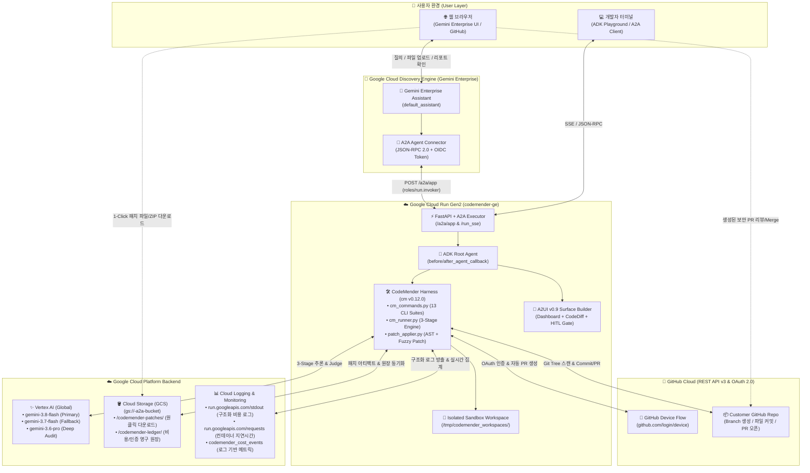
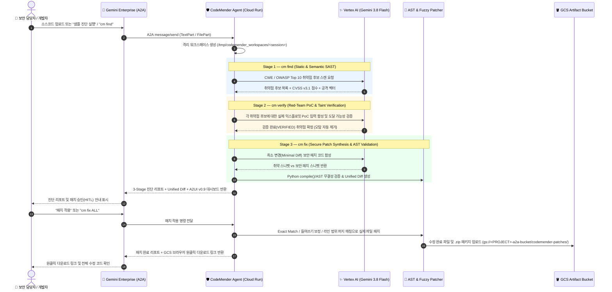
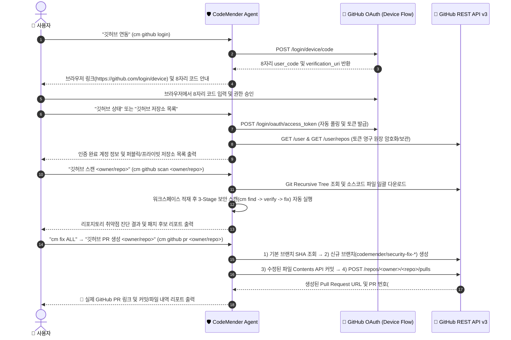

# 🛡️ CodeMender Security Agent for Gemini Enterprise (`codemender-ge`)

[](https://a2a-protocol.org/)
[](https://a2ui.org/)
[](https://adk.dev/)
[](https://cloud.google.com/vertex-ai)
[](#)

**CodeMender Security Agent (`codemender-ge`)**는 Google DeepMind의 **CodeMender (`cm` v0.12.0)** 자율 보안 에이전트 아키텍처를 **Google Cloud Gemini Enterprise (Discovery Engine)** 환경에 완벽하게 통합한 엔터프라이즈 보안 진단 · 취약점 검증 · 자동 패치 · GitHub PR 자동화 에이전트입니다.

누구나 이 저장소를 클론한 뒤 **`.env` 파일에 본인의 GCP 프로젝트 ID(`GOOGLE_CLOUD_PROJECT`) 단 하나만 입력**하고 `./scripts/deploy_and_register_ge.sh`를 실행하면, **인프라 프로비저닝 → Cloud Run 배포 → IAM 권한 부여 → Gemini Enterprise 에이전트 자동 등록**까지 전 과정이 원클릭으로 완료됩니다.

---

## 📑 목차 (Table of Contents)

1. [✨ 핵심 기능 요약 (Key Capabilities)](#-1-핵심-기능-요약-key-capabilities)
2. [🏗️ 시스템 아키텍처 상세 (System Architecture)](#-2-시스템-아키텍처-상세-system-architecture)
   - [2.1 전체 엔드투엔드 인프라 및 A2A/A2UI 아키텍처](#21-전체-엔드투엔드-인프라-및-a2aa2ui-아키텍처)
   - [2.2 3-Stage 자율 보안 파이프라인 (`cm find` → `cm verify` → `cm fix`)](#22-3-stage-자율-보안-파이프라인-cm-find--cm-verify--cm-fix)
   - [2.3 GitHub OAuth 연동 및 자율 보안 PR(Pull Request) 아키텍처](#23-github-oauth-연동-및-자율-보안-prpull-request-아키텍처)
   - [2.4 Billing 권한 불필요(Billing-Free) Cloud Logging 기반 온디맨드 비용 추적](#24-billing-권한-불필요billing-free-cloud-logging-기반-온디맨드-비용-추적)
3. [📋 사전 준비 사항 (Prerequisites)](#-3-사전-준비-사항-prerequisites)
4. [🚀 고객용 단계별 완벽 설치 가이드 (Step-by-Step Onboarding)](#-4-고객용-단계별-완벽-설치-가이드-step-by-step-onboarding)
   - [Step 1: 저장소 클론 및 패키지 설치](#step-1-저장소-클론-및-패키지-설치)
   - [Step 2: `.env` 환경 변수 설정 (상세 가이드)](#step-2-env-환경-변수-설정-상세-가이드)
   - [Step 3: 원클릭 배포 및 Gemini Enterprise 자동 등록](#step-3-원클릭-배포-및-gemini-enterprise-자동-등록)
   - [Step 4: 3단계 E2E 설치 검증 실행](#step-4-3단계-e2e-설치-검증-실행)
5. [💻 Gemini Enterprise 실전 사용 가이드 (5대 시나리오)](#-5-gemini-enterprise-실전-사용-가이드-5대-시나리오)
   - [시나리오 1: 원클릭 샘플 보안 진단 및 자동 패치](#시나리오-1-원클릭-샘플-보안-진단-및-자동-패치)
   - [시나리오 2: 파일/ZIP 업로드 스캔 및 수정본 원클릭 다운로드 (`cm artifacts`)](#시나리오-2-파일zip-업로드-스캔-및-수정본-원클릭-다운로드-cm-artifacts)
   - [시나리오 3: GitHub 저장소 원격 스캔 및 자율 보안 PR 생성 (`cm github`)](#시나리오-3-github-저장소-원격-스캔-및-자율-보안-pr-생성-cm-github)
   - [시나리오 4: 온디맨드(On-Demand) 실시간 비용 및 토큰 정산 조회 (`cm cost`)](#시나리오-4-온디맨드on-demand-실시간-비용-및-토큰-정산-조회-cm-cost)
   - [시나리오 5: 멀티모델 벤치마크 비교 및 엔터프라이즈 감사 리포트 (`SARIF v2.1.0`)](#시나리오-5-멀티모델-벤치마크-비교-및-엔터프라이즈-감사-리포트-sarif-v210)
6. [⌨️ 전체 명령어 레퍼런스 (`cm` v0.12.0 13개 카테고리)](#-6-전체-명령어-레퍼런스-cm-v0120-13개-카테고리)
7. [📂 디렉터리 및 모듈 아키텍처 상세](#-7-디렉터리-및-모듈-아키텍처-상세)
8. [🔧 운영 · 클린 재설치 · 삭제 · 트러블슈팅 가이드](#-8-운영--클린-재설치--삭제--트러블슈팅-가이드)

---

## ✨ 1. 핵심 기능 요약 (Key Capabilities)

| 영역 | 핵심 기능 | 기술적 특징 |
| :--- | :--- | :--- |
| **🔍 3-Stage 자율 보안 엔진** | `cm find` → `cm verify` → `cm fix` | 정적/의미론적 스캔(Stage 1) → Red-Team PoC 합성으로 오탐 제거(Stage 2) → AST/구문 검증 및 퍼지 매칭 보안 패치 합성(Stage 3) |
| **🖥️ A2A v0.3.0 & A2UI v0.9** | 양방향 인터랙티브 보안 대시보드 | Gemini Enterprise 채팅창 호환 Markdown 폴백 + A2UI v0.9 카탈로그(`SeverityBadge`, `CodeDiff`, `PatchApprovalGate`) 동시 방출 |
| **📥 GCS 원클릭 다운로드** | 패치 완료 파일 & ZIP 패키지 영구 보관 | 컨테이너 내부 임시 파일(`/tmp`)의 한계를 극복하여 고객의 GCS 버킷(`gs://<PROJECT>-a2a-bucket`)에 자동 동기화 및 브라우저 즉시 다운로드 링크 제공 |
| **🐙 GitHub OAuth & 자율 PR** | 원격 리포지토리 스캔 & Pull Request 자동 생성 | GitHub OAuth Device Flow(`https://github.com/login/device`) 인증 → 원격 브랜치 생성 → 패치 파일 커밋 → GitHub PR 자동 오픈 |
| **💰 온디맨드 비용 텔레메트리** | Billing API 권한 없이 실시간 비용 추적 | 평소 작업 시에는 화면을 방해하지 않으며, 사용자가 **`비용 조회`(`cm cost`)**를 호출할 때만 Cloud Logging(`entries:list`)과 영구 원장을 분석해 일자별/트랜잭션별 USD·KRW 비용 보고 |
| **⚡ Zero-Hardcoding 배포** | 고객 환경 100% 호환 원클릭 스크립트 | `.env` 파일 설정 후 `./scripts/deploy_and_register_ge.sh` 실행 시 Gemini Enterprise 엔진 자동 탐색부터 Cloud Run 배포 및 A2A 등록까지 전자동 수행 |

---

## 🏗️ 2. 시스템 아키텍처 상세 (System Architecture)

### 2.1 전체 엔드투엔드 인프라 및 A2A/A2UI 아키텍처



---

### 2.2 3-Stage 자율 보안 파이프라인 (`cm find` → `cm verify` → `cm fix`)

CodeMender는 단순 정적 분석기(SAST)의 높은 오탐(False Positive) 문제와 LLM 단독 패치의 구문 파손 문제를 해결하기 위해 **3단계 검증 파이프라인**과 **인간 승인 게이트(HITL)**를 결합합니다.



---

### 2.3 GitHub OAuth 연동 및 자율 보안 PR(Pull Request) 아키텍처

Gemini Enterprise 웹 채팅창 안에서 별도의 CLI 도구 없이 사용자의 GitHub 계정을 인증하고, 원격 리포지토리 스캔부터 보안 패치 브랜치 푸시 및 Pull Request 생성까지 완전 자동화합니다.



---

### 2.4 Billing 권한 불필요(Billing-Free) Cloud Logging 기반 온디맨드 비용 추적

기업 환경에서 개발자나 보안 담당자는 GCP Billing Account 조회 권한(`roles/billing.viewer`)이 없는 경우가 대부분입니다.  
본 에이전트는 **Cloud Billing API 권한 없이도 100% 정확한 비용 추적이 가능하도록 Cloud Logging 이중 파이프라인과 GCS 영구 원장을 결합**했습니다.

- **평소 작업 시 노이즈 제로(Zero-Noise)**: 진단, 패치, GitHub 연동 등 일반 작업 시에는 비용 표를 출력하지 않고 백그라운드에서 구조화 로그(`CODEMENDER_COST_TELEMETRY`)와 원장에만 조용히 기록합니다.
- **온디맨드(On-Demand) 정산 리포트**: 사용자가 **`비용 조회`**, **`얼마 나왔어?`**, **`cm cost`**, **`cm stats`**라고 물어볼 때만 즉시 호출되어 다음 5가지 명세를 보고합니다:
  1. **청구 기간 요약**: 최초 사용일(`YYYY-MM-DD`) ~ 현재 일자까지의 누적 청구액 (`USD` & `KRW`)
  2. **일자별(Daily) 청구 집계표**: 날짜별 실행 횟수, 입력/출력/추론(Thinking) 토큰, LLM 비용, 샌드박스 비용, 일별 합계
  3. **현재 세션(Session) 트랜잭션 상세**: 이번 대화에서 실행한 각 명령어별 소요 시간 및 비용
  4. **전체 누적 트랜잭션 원장(Transaction Ledger)**: 각 트랜잭션 ID(`cm-run-*`, `cm-patch-*`), 시각, 모델, 토큰, 건별 비용
  5. **Cloud Logging (`entries:list`) 실시간 대조**: `run.googleapis.com/stdout` 구조화 로그 + `run.googleapis.com/requests` 컨테이너 점유 시간(`httpRequest.latency`) 실시간 합산

---

## 📋 3. 사전 준비 사항 (Prerequisites)

설치를 진행할 로컬 PC(Mac / Linux / Cloud Shell)에 아래 3가지 도구가 준비되어 있어야 합니다.

1. **Google Cloud SDK (`gcloud`) 설치 및 로그인**
   ```bash
   # GCP 계정 로그인 및 Application Default Credentials(ADC) 설정
   gcloud auth login
   gcloud auth application-default login
   ```
2. **`uv` (초고속 Python 패키지 매니저) 설치**
   ```bash
   curl -LsSf https://astral.sh/uv/install.sh | sh
   ```
3. **`google-agents-cli` 설치 (선택 사항 — 미설치 시에도 `gcloud run deploy`로 자동 폴백)**
   ```bash
   uv tool install google-agents-cli
   ```
4. **GCP 프로젝트 권한 확인**
   - 배포를 실행하는 계정에 대상 GCP 프로젝트의 `Owner` 또는 `Editor` 권한(세부 권한: `Cloud Run Admin`, `Storage Admin`, `Discovery Engine Admin`, `Service Usage Admin`, `Logging Admin`)이 있어야 합니다.
   - 대상 GCP 프로젝트에 **Gemini Enterprise (Discovery Engine App)**가 생성되어 있어야 합니다.

---

## 🚀 4. 고객용 단계별 완벽 설치 가이드 (Step-by-Step Onboarding)

### Step 1: 저장소 클론 및 패키지 설치

```bash
git clone https://github.com/ldu1225/codemender-ge.git
cd codemender-ge

# 가상환경 생성 및 의존성 패키지 설치
uv sync
```

### Step 2: `.env` 환경 변수 설정 (상세 가이드)

저장소 루트에 있는 템플릿 파일(`.env.example`)을 복사하여 `.env` 파일을 생성합니다. (`.env` 파일은 `.gitignore`에 등록되어 있어 Git에 커밋되지 않습니다.)

```bash
cp .env.example .env
```

텍스트 에디터(`nano .env` 또는 VS Code)로 `.env` 파일을 열고 **`GOOGLE_CLOUD_PROJECT`**에 본인의 GCP 프로젝트 ID를 입력합니다:

```ini
# [필수] 1. 고객의 Google Cloud 프로젝트 ID (이 값 하나만 입력해도 바로 작동합니다!)
GOOGLE_CLOUD_PROJECT="my-company-gcp-project"

# [선택] 2. Gemini Enterprise 설정
# - GE_LOCATION: Gemini Enterprise 앱 리전 ("us", "eu", "global" 중 선택, 기본값 "us")
# - GE_ENGINE_ID: 비워두면("") 배포 스크립트가 프로젝트 내 Gemini Enterprise 엔진을 자동으로 찾아 연결합니다!
GE_LOCATION="us"
GE_ENGINE_ID=""

# [선택] 3. Cloud Run 및 Vertex AI 리전 설정
CLOUD_RUN_REGION="us-central1"
GOOGLE_CLOUD_LOCATION="global"
SERVICE_NAME="codemender-ge"
AGENT_DISPLAY_NAME="CodeMender Security Agent (Gemini 3.8 Flash)"

# [선택] 4. CodeMender 추론 모델 및 환율 설정
CODEMENDER_MODEL="gemini-3.8-flash"
CODEMENDER_FALLBACK_MODEL="gemini-3.7-flash"
CM_USD_TO_KRW_RATE="1380.0"

# [선택] 5. 패치 파일 다운로드 및 비용 원장용 GCS 버킷
# - 비워두면("") 자동으로 "${GOOGLE_CLOUD_PROJECT}-a2a-bucket" 이름으로 버킷을 생성합니다.
CM_GCS_ARTIFACT_BUCKET=""

# [선택] 6. GitHub 연동 설정
# - 비워두면("") 채팅창에서 `깃허브 연동` 입력 시 표준 GitHub Device Flow(8자리 코드 인증)가 작동합니다.
# - 사내 전용 GitHub OAuth App이나 Personal Access Token(PAT)을 미리 주입하려면 아래에 입력하세요.
GITHUB_OAUTH_CLIENT_ID=""
GITHUB_TOKEN=""
```

#### 📊 환경 변수 상세 요약표

| 변수명 | 필수 여부 | 기본값 (비워둘 경우) | 설명 |
| :--- | :---: | :--- | :--- |
| **`GOOGLE_CLOUD_PROJECT`** | **✅ 필수** | 없음 | 배포할 대상 Google Cloud 프로젝트 ID |
| `GE_LOCATION` | 선택 | `us` | Gemini Enterprise(Discovery Engine) 멀티 리전 (`us`, `eu`, `global`) |
| `GE_ENGINE_ID` | 선택 | **자동 탐색** | 비워두면 프로젝트 내 최신 Gemini Enterprise Engine ID를 API로 자동 조회 |
| `CLOUD_RUN_REGION` | 선택 | `us-central1` | Cloud Run 서비스가 배포될 리전 |
| `GOOGLE_CLOUD_LOCATION` | 선택 | `global` | Vertex AI Gemini 모델 엔드포인트 리전 (`global` 권장) |
| `SERVICE_NAME` | 선택 | `codemender-ge` | Cloud Run 서비스 이름 |
| `AGENT_DISPLAY_NAME` | 선택 | `CodeMender Security Agent (Gemini 3.8 Flash)` | Gemini Enterprise 에이전트 목록에 표시될 이름 |
| `CODEMENDER_MODEL` | 선택 | `gemini-3.8-flash` | 기본 보안 추론 및 검증 모델 |
| `CODEMENDER_FALLBACK_MODEL` | 선택 | `gemini-3.7-flash` | 기본 모델 호출 실패 시 자동 전환될 폴백 모델 |
| `CM_GCS_ARTIFACT_BUCKET` | 선택 | `<PROJECT_ID>-a2a-bucket` | 수정된 소스파일 원클릭 다운로드 및 비용/인증 원장 저장용 GCS 버킷 |
| `GITHUB_OAUTH_CLIENT_ID` | 선택 | 표준 GitHub CLI Device Flow | 커스텀 GitHub OAuth App Client ID (선택) |
| `GITHUB_TOKEN` | 선택 | 없음 | GitHub Personal Access Token 사전 주입 시 사용 (선택) |

---

### Step 3: 원클릭 배포 및 Gemini Enterprise 자동 등록

이제 아래 스크립트 한 줄만 실행하면 모든 설치가 자동으로 진행됩니다:

```bash
./scripts/deploy_and_register_ge.sh
```

#### 🔍 스크립트가 자동으로 수행하는 5단계 프로비저닝 과정:
1. **`[1/5] Preparing GCP Project & Provisioning Resources`**
   - 프로젝트 번호(`PROJECT_NUMBER`) 조회 및 `GE_ENGINE_ID` 자동 탐색
   - 필수 API 8종(`run`, `cloudbuild`, `artifactregistry`, `aiplatform`, `discoveryengine`, `logging`, `monitoring`, `storage`) 자동 활성화
   - GCS 버킷(`gs://<PROJECT_ID>-a2a-bucket`) 존재 여부 확인 및 미존재 시 자동 생성
   - Cloud Logging 비용 메트릭(`codemender_cost_events`) 존재 여부 확인 및 자동 생성
2. **`[2/5] Deploying CodeMender Agent to Cloud Run`**
   - 소스코드 컨테이너 빌드 및 Cloud Run Gen2 배포 (`.env` 환경 변수 자동 주입)
3. **`[3/5] Configuring IAM Permissions`**
   - Discovery Engine 서비스 계정(`service-<PROJECT_NUMBER>@gcp-sa-discoveryengine.iam.gserviceaccount.com`)에 Cloud Run 호출 권한(`roles/run.invoker`) 자동 부여
4. **`[4/5] Registering CodeMender A2A + A2UI v0.9 Agent in Gemini Enterprise`**
   - 배포된 Cloud Run의 `/.well-known/agent-card.json`을 읽어 Discovery Engine REST API(`v1alpha`)를 통해 Gemini Enterprise의 에이전트로 자동 등록(또는 기존 에이전트 업데이트)
5. **`[5/5] Deployment & Registration Complete`**
   - 배포된 Cloud Run 엔드포인트 및 등록된 Gemini Enterprise 에이전트 리소스 ID 출력

---

### Step 4: 3단계 E2E 설치 검증 실행

배포가 정상적으로 완료되었는지 로컬/클라우드/Gemini Enterprise 3단계를 한 번에 테스트하려면 아래 명령어를 실행합니다:

```bash
./scripts/deploy_and_register_ge.sh --test
```

- **`[Test 1/3]`**: 로컬 ADK `/run_sse` 엔드포인트 멀티턴 테스트 (`안녕` → `샘플 진단 실행` → `패치 적용` → `비용 조회`)
- **`[Test 2/3]`**: 라이브 Cloud Run `/a2a/app` JSON-RPC 멀티턴 테스트 (`안녕` → `샘플 진단 실행` → `cm triage` → `cm fix` → `cm artifacts` → `cm stats`)
- **`[Test 3/3]`**: Gemini Enterprise Discovery Engine 에이전트 등록 상태(`ENABLED`) 검증

---

## 💻 5. Gemini Enterprise 실전 사용 가이드 (5대 시나리오)

Gemini Enterprise 웹 콘솔 좌측 메뉴의 **Agents(에이전트)** 탭에서 **`CodeMender Security Agent (Gemini 3.8 Flash)`**를 선택하고 아래 시나리오대로 대화해 보세요.

### 시나리오 1: 원클릭 샘플 보안 진단 및 자동 패치
1. **`안녕`** 입력 → 에이전트가 지원하는 전체 `cm` 명령어 가이드 및 상태 대시보드 확인
2. **`샘플 진단 실행`** 입력 → 내장된 결제 서비스(`vulnerable_payment_service.py`)에 대해 3-Stage 스캔(`cm find` → `cm verify` → `cm fix`) 실행, CWE-89 SQL Injection 및 CWE-78 OS Command Injection 검출 및 Unified Diff 확인
3. **`패치 적용`** (또는 **`cm fix ALL`**) 입력 → 보안 패치가 실제 파일에 적용되고, AST 구문 무결성 검증 결과 및 **GCS 원클릭 다운로드 링크**가 즉시 출력됨

### 시나리오 2: 파일/ZIP 업로드 스캔 및 수정본 원클릭 다운로드 (`cm artifacts`)
1. 채팅창의 **`+` (파일 첨부)** 버튼을 눌러 취약한 `.py`, `.c`, `.js`, `.go`, `.java` 파일 또는 프로젝트 `.zip` 아카이브를 첨부하고 **`이 파일 보안 진단해줘`** 입력
2. 진단 완료 후 **`cm fix ALL`** 입력하여 전체 취약점 자동 패치
3. **`수정한 파일 어디에 저장되어 있어?`** 또는 **`cm artifacts`** 입력 →
   - **① 브라우저 원클릭 개별 파일 다운로드 링크**
   - **② 전체 패치 파일 `.zip` 패키지 원클릭 다운로드 링크**
   - **③ GCS 영구 경로(`gs://...`) 및 수정된 전체 소스코드 전문** 확인

### 시나리오 3: GitHub 저장소 원격 스캔 및 자율 보안 PR 생성 (`cm github`)
1. **`깃허브 연동`** (`cm github login`) 입력 → 화면에 안내된 [https://github.com/login/device](https://github.com/login/device) 링크를 클릭하고 **8자리 인증 코드** 입력
2. **`깃허브 저장소 목록`** (`cm github repos`) 입력 → 내 GitHub 계정의 퍼블릭/프라이빗 리포지토리 목록 확인
3. **`깃허브 스캔 <소유자/저장소명>`** (예: `깃허브 스캔 my-org/my-service`) 입력 → GitHub 저장소의 소스 파일들을 자동으로 가져와 3-Stage 보안 스캔 수행
4. **`cm fix ALL`** 입력 → 검출된 취약점 일괄 보안 패치 적용 및 구문 검증
5. **`깃허브 PR 생성 <소유자/저장소명>`** (예: `깃허브 PR 생성 my-org/my-service`) 입력 →
   - 원격 GitHub 저장소에 `codemender/security-fix-YYYYMMDD-*` 브랜치 자동 생성
   - 패치된 모든 파일 자동 커밋
   - **실제 GitHub Pull Request 자동 오픈 및 PR 링크 반환!**

### 시나리오 4: 온디맨드(On-Demand) 실시간 비용 및 토큰 정산 조회 (`cm cost`)
- 채팅창에 **`비용 조회`**, **`얼마 나왔어?`**, 또는 **`cm cost`** 입력
- 최초 사용일부터 오늘 날짜까지의 **총 청구 비용(USD / KRW)**, **일자별(Daily) 청구 집계표**, **현재 세션 및 전체 누적 트랜잭션 원장**, 그리고 **Cloud Logging 실시간 대조표**를 한눈에 확인합니다.

### 시나리오 5: 멀티모델 벤치마크 비교 및 엔터프라이즈 감사 리포트 (`SARIF v2.1.0`)
- **`cm test-all-models`** 입력 → 현재 워크스페이스 코드에 대해 `gemini-3.8-flash`, `gemini-3.7-flash`, `gemini-3.6-pro` 3개 모델의 탐지율, 패치 성공률, 추론 속도, 예상 비용을 비교하는 벤치마크 매트릭스 생성
- **`cm report -f json`** 입력 → GitHub Advanced Security(CodeQL)에 바로 업로드할 수 있는 **SARIF v2.1.0 표준 JSON 리포트** 생성
- **`cm report -f html`** 입력 → 경영진/보안 감사 제출용 HTML 보안 감사 보고서 생성

---

## ⌨️ 6. 전체 명령어 레퍼런스 (`cm` v0.12.0 13개 카테고리)

자연어(한국어/영어) 또는 아래 `cm` CLI 명령어를 채팅창에 그대로 입력할 수 있습니다:

| # | 카테고리 | 명령어 (CLI / 자연어) | 설명 |
| :-: | :--- | :--- | :--- |
| **1** | **초기화** | `cm init [--verify]` | 격리 샌드박스 워크스페이스 초기화 및 Vertex AI/컴파일러 상태 점검 |
| **2** | **취약점 탐지 (Stage 1)** | `cm find [<path>] [--model <model>]` | 정적/의미론적 취약점 스캔 및 CWE/OWASP 매핑 (`샘플 진단 실행`) |
| **3** | **PoC 검증 (Stage 2)** | `cm verify [<id\|ALL>] [--bypass-warning]` | Red-Team 익스플로잇 PoC 합성 및 오탐 제거 검증 |
| **4** | **보안 패치 (Stage 3)** | `cm fix [<id\|ALL>] [-c "<지침>"] [--revert]` | 보안 패치 생성·적용, 커스텀 지침(`-c`) 반영, 또는 원본 롤백(`--revert`) |
| **5** | **트리아지 & 게이트** | `cm triage` | CVSS v3.1 기반 P0~P3 우선순위 매트릭스 및 CI/CD Security Gate(`PASS`/`BLOCK`) 판정 |
| **6** | **감사 리포트** | `cm report [-f text\|json\|html]` | 텍스트 요약, **SARIF v2.1.0 JSON**, 또는 엔터프라이즈 HTML 보고서 출력 |
| **7** | **형상 관리 (VCS)** | `cm vcs status \| diff \| stage \| reset` | 수정된 파일 상태, Git Unified Diff, 커밋 메시지 생성, 워크스페이스 초기화 |
| **8** | **빌드 & 회귀 검증** | `cm build [--force]` | 패치 후 Python AST / C(`clang`/`gcc`) / JS(`node --check`) 구문 및 회귀 검증 |
| **9** | **멀티모델 벤치마크** | `cm models` / `cm test-all-models` / `cm switch-model <m>` | 지원 모델 제원 비교, 3개 모델 동시 벤치마크, 세션 활성 모델 즉시 전환 |
| **10** | **온디맨드 비용 정산** | `cm cost` / `cm stats` / `비용 조회` | Cloud Logging + 영구 원장 기반 일자별·트랜잭션별 토큰 및 비용(USD/KRW) 정산 |
| **11** | **세션 타임라인** | `cm sessions` | 현재 세션의 명령어 실행 이력 및 단계별 소요 시간/비용 타임라인 |
| **12** | **아티팩트 다운로드** | `cm artifacts` / `cm download` / `다운로드` | 패치된 파일 및 `.zip` 번들의 GCS 원클릭 다운로드 링크 및 전체 소스 출력 |
| **13** | **GitHub 연동 & PR** | `cm github login \| status \| repos \| scan \| pr` | GitHub OAuth 인증, 저장소 목록, 원격 코드 스캔, 자율 보안 Pull Request 생성 |

---

## 📂 7. 디렉터리 및 모듈 아키텍처 상세

```text
codemender-ge/
├── .env.example                     # 고객용 환경 변수 템플릿 (복사하여 .env로 사용)
├── Dockerfile                       # Cloud Run Gen2 배포용 Python 3.12 + uv 컨테이너 이미지
├── pyproject.toml                   # 프로젝트 의존성 및 pytest/ruff 설정
├── scripts/
│   └── deploy_and_register_ge.sh    # 원클릭 프로비저닝, 배포, GE 등록, 삭제, E2E 검증 스크립트
├── bin/
│   └── cm                           # 컨테이너 내부 로컬 cm v0.12.0 CLI 바이너리 래퍼
├── samples/
│   ├── vulnerable_payment_service.py# Python 샘플 취약 코드 (SQLi, Command Injection 등)
│   └── vulnerable_gateway.c         # C 샘플 취약 코드 (Buffer Overflow, Format String 등)
├── app/
│   ├── config.py                    # Zero-Hardcoding 동적 환경 변수 로더 (.env 자동 로드)
│   ├── agent.py                     # ADK Root Agent & before/after_agent_callback 오케스트레이터
│   ├── fast_api_app.py              # Cloud Run FastAPI 서버 (/a2a/app 및 /run_sse 엔드포인트)
│   ├── a2ui_renderer/
│   │   ├── catalogs/
│   │   │   └── codemender_v0_9_catalog.json  # A2UI v0.9 커스텀 보안 컴포넌트 카탈로그
│   │   ├── schema_manager.py        # A2A <-> ADK 이벤트 변환 및 A2UI DataPart 주입기
│   │   └── surface_builder.py       # A2UI v0.9 인터랙티브 대시보드 및 CodeDiff 빌더
│   ├── harness/
│   │   ├── cm_commands.py           # cm v0.12.0 13개 명령어 파서 및 마크다운 리포트 생성기
│   │   ├── cm_runner.py             # 3-Stage (find -> verify -> fix) 파이프라인 실행 엔진
│   │   ├── patch_applier.py         # AST 검증 + 들여쓰기/라인 범위 퍼지 매칭 패치 엔진
│   │   ├── github_integration.py    # GitHub OAuth Device Flow, 원격 트리 스캔, 자동 PR 생성기
│   │   └── cost_tracker.py          # Cloud Logging (entries:list) + GCS 영구 비용 원장 추적기
│   └── ingestion/
│       └── file_manager.py          # 격리 워크스페이스 관리, ZIP/파일 인제스천, GCS 퍼블리셔
└── tests/
    ├── unit/                        # 단위 테스트 스위트 (14개 핵심 검증 케이스)
    └── integration/                 # 통합 테스트 스위트
```

---

## 🔧 8. 운영 · 클린 재설치 · 삭제 · 트러블슈팅 가이드

### 주요 운영 명령어
```bash
# 1. 코드 수정 후 재배포 및 Gemini Enterprise 업데이트
./scripts/deploy_and_register_ge.sh

# 2. Cloud Run 재빌드 없이 Gemini Enterprise 에이전트 카드만 빠르게 재등록
./scripts/deploy_and_register_ge.sh --register-only

# 3. 기존 Gemini Enterprise 에이전트와 Cloud Run을 완전히 삭제하고 처음부터 클린 재설치 + E2E 검증
./scripts/deploy_and_register_ge.sh --clean-reinstall

# 4. 에이전트 등록 해제 및 Cloud Run 서비스 완전 삭제
./scripts/deploy_and_register_ge.sh --uninstall

# 5. Cloud Run 실시간 로그 확인
./scripts/deploy_and_register_ge.sh --logs

# 6. 로컬 단위 테스트 실행
uv run pytest tests/unit -v
```

### 자주 묻는 질문 (Troubleshooting)

- **Q1. `GE_ENGINE_ID`를 어디서 확인하나요?**
  - 확인하실 필요가 없습니다! `.env` 파일에서 `GE_ENGINE_ID=""`로 비워두시면 `./scripts/deploy_and_register_ge.sh`가 프로젝트 내 Discovery Engine 목록을 조회하여 자동으로 최신 Gemini Enterprise 엔진을 연결합니다. 수동 지정을 원하시면 Google Cloud Console → **Agent Builder (Gemini Enterprise)** → **Apps**에서 앱 ID를 복사해 넣으시면 됩니다.
- **Q2. 배포 시 `403 Forbidden` 권한 오류가 발생합니다.**
  - `gcloud auth login` 계정이 올바른지 확인하세요 (`gcloud config get-value account`). 배포 스크립트는 로컬의 오래된 ADC 파일 충돌을 방지하고 현재 활성화된 `gcloud` 인증 세션을 우선 사용하도록 자동 설계되어 있습니다.
- **Q3. GitHub PR 생성 시 수정된 파일이 `0개`라고 나옵니다.**
  - PR을 생성하기 전에 먼저 스캔된 코드에 패치를 적용해야 합니다. **`깃허브 스캔 <owner/repo>`** 실행 후 **`cm fix ALL`**(또는 **`패치 적용`**)을 먼저 실행한 다음 **`깃허브 PR 생성 <owner/repo>`**를 입력해 주세요.

---

## 📄 라이선스 (License)

Copyright 2026 Google LLC. Licensed under the [Apache License, Version 2.0](LICENSE).
